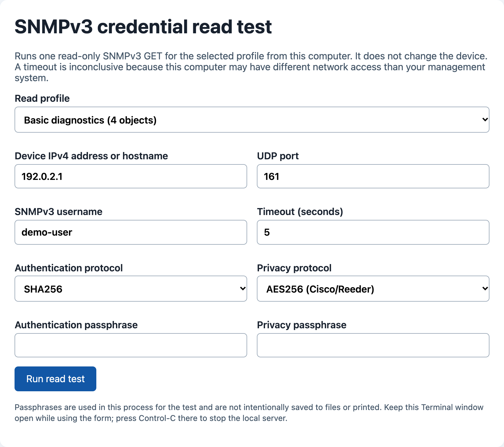

# Local SNMPv3 Read Test

This local browser form sends one read-only SNMPv3 GET from **your computer**
to the device you enter. The default profile requests **sysUpTime.0**
(1.3.6.1.2.1.1.3.0). It does not change device or network-management
configuration.

*Example fields only. No passphrases or live device details are shown.*

## Start

Double-click [Run SNMPv3 Probe.command](Run%20SNMPv3%20Probe.command) in Finder,
or run it from Terminal. The first launch creates a local .venv and installs
the pinned Python packages in requirements.txt; it needs Python 3.11 or newer
and package-download access. Later launches reuse the environment. The launcher
opens the form in the Mac's default browser and prints its local URL in Terminal.
If the browser does not open, copy that URL into Safari or Chrome.

Enter the device IPv4 address or DNS hostname, SNMPv3 username, authentication
and privacy passphrases, and the matching protocols. Defaults are **SHA256**
and **Cisco/Reeder AES256**; change them to match your device. The form also offers
SHA1, AES128, and Blumenthal AES256 for devices configured differently. The
default UDP port is 161; the default timeout is five seconds with no retries.
Choose **Uptime only** or **Basic diagnostics**. Basic diagnostics requests
sysUpTime.0, sysDescr.0, sysObjectID.0, and snmpEngineID.0 in one GET and shows
each result separately. An unavailable object may be unsupported or outside the
device's SNMP view; it does not by itself mean authentication failed.
After each result, the device and username remain in the form for another
test. The passphrase fields are blank.

Press **Control-C** in the launcher Terminal window to stop the local server.
You can also run the following command to print the URL without opening a browser:

    .venv/bin/python app.py --no-browser

For a manual macOS/Linux setup, run:

    python3 -m venv .venv
    .venv/bin/python -m pip install -r requirements.txt
    .venv/bin/python app.py

The local checks do not contact an SNMP device:

    .venv/bin/python -m unittest -v test_app

## Reading results

- **Authenticated read succeeded** means this computer received every value
  requested by the selected profile.
- **Authenticated SNMP reply received** with an error or unavailable OID
  means the device replied, but one or more requested values were not returned.
- **WrongDigest**, unknown username, or a privacy error identifies the
  protocol stage reported by PySNMP; it does not by itself establish why the
  device and manager disagree.
- **No response from this computer** is inconclusive for the credentials.
  Check routing, UDP reachability, source ACLs, and device configuration.
  A different management system may have a working path while this computer
  times out.

The test is direct from your computer. It does not read another management
system's assigned credentials or establish which credentials that system
will select.

## Local handling

The web server binds only to 127.0.0.1 on a random port. It uses a random
session URL and a form token, suppresses HTTP access logging, and sends
no-store response headers. Passphrases are sent in the local POST body and used
in the SNMPv3 client process. The utility does not intentionally save or print
them; Python and the browser can retain data in memory while running. No
passphrase belongs in the URL, Terminal command, repository, screenshot, or
incident notes.

Only IPv4 transport is currently supported. The probe sends no SNMP SET.

## License

Apache-2.0. See [LICENSE](LICENSE).
